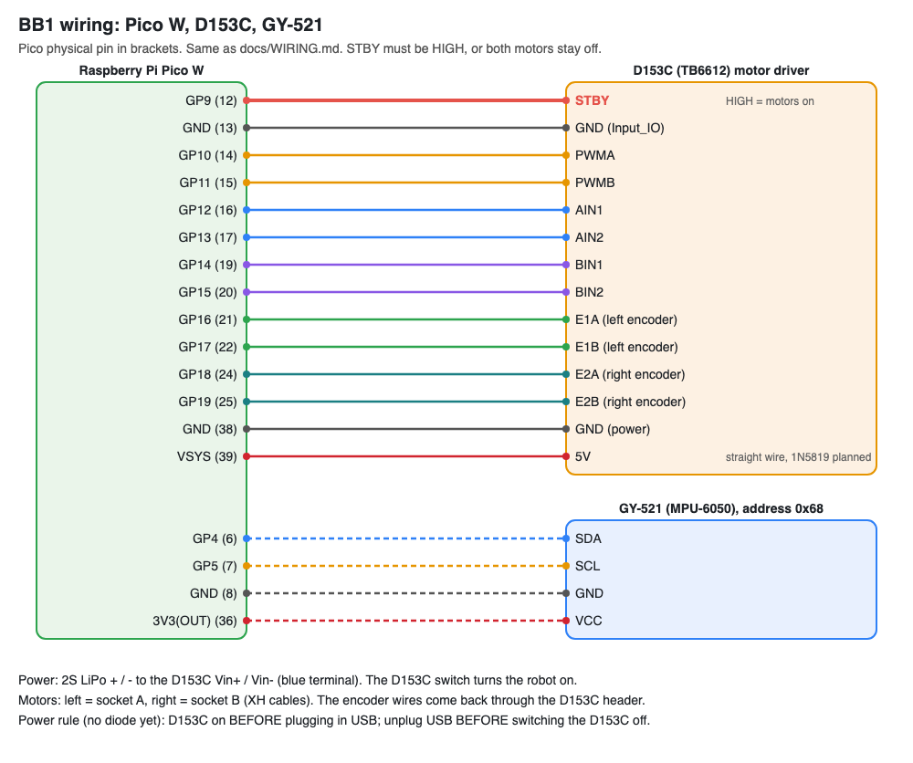

# Wiring

Pico physical pin numbers in brackets. D153C pin names follow its silkscreen.

The picture is drawn from the tables below by `tools/make_wiring_svg.py` (`wiring.svg`, and `wiring.png` for phones). Change a wire: update the table here and the list in that script, run it, then re-save the PNG (open `wiring.svg` in Chrome and screenshot, or see `docs/TOOLS.md`).

## Power

| From | To | Notes |
|---|---|---|
| 2S LiPo + / - | D153C Vin+ / Vin- (blue terminal) | D153C switch turns the robot on |
| D153C 5V | Pico VSYS (39) | Straight wire for now; a 1N5819 (stripe toward the Pico) is planned |
| D153C GND | Pico GND (38) | Common ground |

**Power rule until the diode is in:** switch the D153C on before plugging in USB, and unplug USB before switching it off.

## D153C to Pico

| D153C | Pico |
|---|---|
| STBY | GP9 (12), HIGH = on |
| GND (Input_IO) | GND (13) |
| PWMA | GP10 (14) |
| PWMB | GP11 (15) |
| AIN1 / AIN2 | GP12 (16) / GP13 (17) |
| BIN1 / BIN2 | GP14 (19) / GP15 (20) |
| E1A / E1B | GP16 (21) / GP17 (22) |
| E2A / E2B | GP18 (24) / GP19 (25) |

Motors plug into the D153C sockets with their XH cables: left = A, right = B.

## MPU-6050 (GY-521) to Pico

| GY-521 | Pico |
|---|---|
| VCC | 3V3(OUT) (36) |
| GND | GND (8) |
| SCL | GP5 (7) |
| SDA | GP4 (6) |
| XDA, XCL, AD0, INT | not connected (address 0x68) |

## Planned

| Part | Connection |
|---|---|
| HC-SR04 | VCC to D153C 5V, GND to GND, Trig to GP20 (26), Echo through 1k to GP21 (27) with 2k from GP21 to GND (HC-SR04P: 3V3 and no resistors) |
| Battery sense | Battery + through 100k to GP26 (31), 33k to GND (8.4 V reads about 2.1 V) |
| OLED | I2C1 on GP6 (9) / GP7 (10) |
| Pi Zero W | Pico GP0 TX (1) to Pi pin 10, Pico GP1 RX (2) from Pi pin 8, 5V and GND from the D153C |
